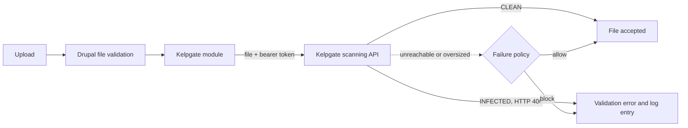

# Kelpgate Malware Scanner for Drupal

**Reject infected files during validation, before Drupal saves them.**

Kelpgate Malware Scanner sends files uploaded to Drupal to the Kelpgate scanning service as part of file validation. Infected files are rejected with a validation error, and every detection is written to the Drupal log.

> This module is open source under GPL-2.0-or-later. It is a client for the Kelpgate scanning service, a hosted commercial product that is not part of this repository. You need a Kelpgate account to use it.

## Contents

[Why Kelpgate](#why-kelpgate) · [How it works](#how-it-works) · [Install](#install) · [Configuration](#configuration) · [Secrets](#secrets) · [Failure policy](#failure-policy) · [Security and privacy](#security-and-privacy) · [Compatibility](#compatibility) · [Verify your setup](#verify-your-setup) · [Troubleshooting](#troubleshooting) · [Contributing and security](#contributing-and-security) · [License](#license)

## Why Kelpgate

| | |
| --- | --- |
| **Native integration** | Implements `hook_file_validate()`, so file fields, Media Library and CKEditor image uploads are all covered without extra wiring. |
| **Low memory use** | Files are streamed to the API instead of being loaded into memory. |
| **Predictable failure behaviour** | Choose whether uploads are rejected or accepted when the scanner is unreachable or a file is too large. |
| **Secrets kept out of exported config** | The client secret lives in `settings.php` or Drupal state, never in `kelpgate.settings`. |
| **Auditable** | Detections are logged to the `kelpgate` channel with the file's SHA-256. |

## How it works



The module obtains an OAuth 2.0 access token with your client credentials, caches it and renews it shortly before expiry, then streams the file to the scanning API over HTTPS. Only an infected verdict (HTTP 406) rejects a file.

## Install

**Requirements:** Drupal 9.5, 10 or 11, PHP 7.4 or later, and a Kelpgate account (client ID and client secret from the Kelpgate Console).

```bash
git clone https://github.com/JustBots-Labs/kelpgate-drupal-module.git modules/contrib/kelpgate
drush en kelpgate
```

Or download the repository, place it in `modules/contrib/kelpgate` and enable it from **Extend**. The module is not on Packagist yet, so `composer require kelpgate/kelpgate` does not work; to install with Composer, first add this repository with `composer config repositories.kelpgate vcs https://github.com/JustBots-Labs/kelpgate-drupal-module`, then `composer require kelpgate/kelpgate:dev-main`. Then open `/admin/config/security/kelpgate` and enter the API URL, token URL, client ID and client secret. Access requires the `administer kelpgate` permission.

## Configuration

Settings live in `kelpgate.settings`:

| Key | Default | Meaning |
| --- | --- | --- |
| `enabled` | `true` | Turn scanning on or off. |
| `api_url` | none | Base URL of the scanning API (HTTPS; plain HTTP only for localhost). |
| `token_url` | none | OAuth 2.0 token endpoint (HTTPS). |
| `auth_mode` | `oauth2` | `oauth2`, or `token` for a static bearer token. |
| `client_id` | none | OAuth 2.0 client ID. |
| `fail_action` | `block` | `block` or `allow` when the scanner cannot give a verdict. |
| `max_scan_mb` | `50` | Largest file that is scanned. |
| `timeout_seconds` | `45` | HTTP timeout for scanner requests. |

Pin values per environment in `settings.php`:

```php
$config['kelpgate.settings']['api_url']   = 'https://api.example.com';
$config['kelpgate.settings']['token_url'] = 'https://auth.example.com/oauth2/token';
$config['kelpgate.settings']['client_id'] = getenv('KELPGATE_CLIENT_ID');
```

## Secrets

The client secret is read in this order: `settings.php`, then Drupal state (what the settings form writes), then legacy configuration from older installs, which is migrated on the next save.

```php
$settings['kelpgate_client_secret'] = getenv('KELPGATE_CLIENT_SECRET');
// auth_mode "token" uses: $settings['kelpgate_api_token']
```

## Failure policy

| Situation | `block` (default) | `allow` |
| --- | --- | --- |
| Scanner unreachable or returns an error | File rejected | File accepted |
| Authentication fails | File rejected | File accepted |
| File larger than `max_scan_mb` | File rejected | File accepted |

## Security and privacy

- **What leaves your server:** the uploaded file and its name go to the API URL you configure, over HTTPS.
- **Access control:** the settings form requires the `administer kelpgate` permission.
- **Secrets:** never stored in exported configuration; see [Secrets](#secrets).
- **Rejection message:** visitors see a generic notice with a short detection name or error code (for example `Eicar-Test-Signature` or `HTTP_500`). Full details, including the SHA-256, go to the log.

To report a vulnerability, please use this repository's private security advisory (Security, then Report a vulnerability) or email security@kelpgate.cloud.

## Compatibility

Every combination below was installed on a real Drupal site with the module enabled and checked: a clean file is accepted, an EICAR file is rejected, and both failure policies behave as set. The scanning API was simulated for these runs.

| Drupal | PHP |
| --- | --- |
| 9.5 | 8.0, 8.1 |
| 10.1 | 8.1 |
| 10.3 | 8.2 |
| 10.6 | 8.3 |
| 11.3 | 8.3 |
| 11.4 | 8.4 |

All source files also lint cleanly on PHP 7.4 through 8.4. Combinations not listed have not been tested; Drupal 9.5 on PHP 7.4 could not be run because no image exists for it.

## Verify your setup

Upload a file containing the standard EICAR test string through any file or media field:

```
X5O!P%@AP[4\PZX54(P^)7CC)7}$EICAR-STANDARD-ANTIVIRUS-TEST-FILE!$H+H*
```

The upload is rejected, and a message appears under **Reports > Recent log messages**.

## Troubleshooting

| Symptom | Likely cause |
| --- | --- |
| Every upload is rejected | The scanner is unreachable or credentials are wrong while `fail_action` is `block`. Check the `kelpgate` log entries. |
| Nothing is ever blocked | Scanning is disabled, the module is not configured, or `fail_action` is `allow` during an outage. |
| Authentication errors after changing the secret | Clear the cache so the cached token is dropped, and confirm which of `settings.php` or state holds the secret. |
| Log says the API URL must use https | The API or token URL is not HTTPS. |

## Contributing and security

Bug reports and pull requests are welcome; see the [contributing guide](https://github.com/JustBots-Labs/.github/blob/main/CONTRIBUTING.md). To report a vulnerability, follow the [security policy](https://github.com/JustBots-Labs/.github/blob/main/SECURITY.md) and report it privately. For help, see [getting help](https://github.com/JustBots-Labs/.github/blob/main/SUPPORT.md).

## License

GPL-2.0-or-later. See [LICENSE](LICENSE).
